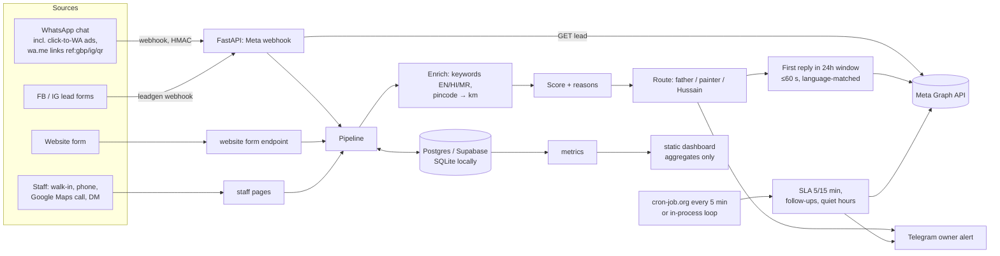

# speed-to-lead — WhatsApp-first lead response for a paint shop in Pune

**Production status: Week 0 — baseline logging not started.** No real customer data has been collected
yet. The public dashboard (`site/index.html`) is real and currently shows 0 leads; it fills as the shop
logs enquiries. Every number below this line comes from the **synthetic** demo (`make demo`) and proves
the pipeline works, not that the business improved.

## Problem
United Trader is a paint retail shop in Undri, Pune (run day to day by Hussain's father, roughly
₹10–12 lakh revenue a month, many competitors within a few km). Enquiries come from Google Maps,
Instagram/Facebook ads and DMs, click-to-WhatsApp ads, a website form, phone calls and walk-ins. Replies
depend on whoever is free at the counter, so they can take minutes or hours, out-of-hours messages wait
until morning, and nobody knows which source brings actual sales. A painting customer who asks three
shops for a rate usually buys from the first one that answers properly.

## What is built
| Part | What it does |
|---|---|
| Webhook service (FastAPI, Docker) | `GET/POST /webhooks/meta`: WhatsApp Cloud API + Meta Lead Ads on one URL, verify-token handshake, `X-Hub-Signature-256` HMAC check on every POST, 200 returned immediately, work done right after |
| Website form | `POST /webhooks/form` (JSON or form), consent checkbox required, honeypot, returns a `wa.me` link so the visitor starts a free WhatsApp chat |
| Staff pages (Hindi/English, phone-first) | `/staff` lead list, lead page with score reasons, buttons: replied, send WhatsApp, quote ₹, won ₹, lost; `/staff/new` manual entry for walk-ins / calls / Google Maps calls / DMs; `/staff/baseline` logbook |
| Lead store | Portable SQL migrations: SQLite locally, Postgres on Supabase (+ row-level security). Phone normalised to `+91…`, dedupe by phone, idempotent events (Meta retries are no-ops) |
| Enrichment | Keyword rules in English, Hindi, Marathi (Devanagari + typed in Latin letters: "seelan", "kitna rate", "majha ghar"): project type, size (2BHK / sq ft / bungalow), budget, timeline, contractor vs homeowner, brand, price intent, area/pincode → km from shop. Optional LLM fill-in (off by default) |
| Score | 0–100, one line per rule, e.g. `+20 timeline: now ('jaldi')` |
| Routing | father (counter, contractors), painter partner (site jobs, waterproofing), Hussain (out-of-area, unclear digital leads) |
| First response | Session reply in the customer's language within seconds: thanks, price-list link, 2 qualifying questions picked from what is still unknown, STOP footer. Out of hours: "closed, we'll reply tomorrow at 9:30 AM" |
| SLA | No human reply 5 min after shop-open time → alert to owner; 15 min → escalate. Clock waits for opening time for night enquiries |
| Follow-ups | 2 h and 22 h after the auto-reply, only inside the free 24 h window, only in shop hours, never after a human took over or after STOP |
| Opt-out & consent | STOP / बंद करो / थांबवा / UNSUBSCRIBE → no more messages; START → resume. Consent source + time stored per lead. DPDP erasure command |
| Owner alerts | Telegram (free). WhatsApp to owners only when free (owner pinged the number in the last 24 h) |
| Metrics + dashboard | Auto first-response median/p90 and % ≤60 s, human first-response median/p90 and % ≤5 min, volume/funnel/revenue by source, baseline vs live. Static anonymised HTML |
| Baseline | Plan (`docs/baseline-plan.md`), phone logbook page, paper template + CSV import |
| Templates | 4 Meta templates × English + Hindi, ready to submit (`templates/whatsapp_templates.json`), switched off by default because they cost money |
| Demo | `make demo`: fake Meta + Telegram server, real HTTP, 11 labelled synthetic leads, 17 pass/fail checks |

## Architecture


## How to run
```bash
make install        # Python 3.11 venv + deps
make check          # ruff, mypy --strict, pytest
make demo           # synthetic end-to-end run -> demo_output/
make serve          # local server on :8000 (STL_DRY_RUN=true by default: nothing is sent)
make dashboard      # anonymised dashboard from REAL data -> site/index.html
python -m speed_to_lead tick                     # one SLA/follow-up pass
python -m speed_to_lead baseline-import file.csv # paper logbook -> DB
python -m speed_to_lead forget +91XXXXXXXXXX     # DPDP erasure
```
Configuration is environment variables only (`.env.example`). Owner setup: **[SETUP.md](SETUP.md)**;
shop staff: **[docs/SETUP_HI.md](docs/SETUP_HI.md)** (Hindi, 1 page).

## Results
### Production (real): pending
Week 0. Baseline logging has not started. Real dashboard right now (`make dashboard` output):
`Week 0 — baseline logging not started... leads=0 baseline_entries=0`.

What will be measured, and how:
| Metric | Source | Before (baseline) | After (live) |
|---|---|---|---|
| First human reply: median, p90 (minutes from shop-open time) | baseline logbook / staff "replied" button | 2 weeks, manual | automatic |
| % enquiries answered by a human within 5 min | same | ✓ | ✓ |
| Enquiries never answered | same | ✓ | SLA alerts make this visible |
| First automated reply: median, p90, % ≤60 s | webhook receive time → Meta API accepted | n/a | automatic |
| Leads by source | ref tags, CTWA referral, lead-ad form id, staff dropdown | ✓ | ✓ |
| Funnel lead → quote → sale, revenue by source | staff buttons (quote ₹, invoice ₹) | ✓ | ✓ |

Plan: 14 days baseline → go live → compare after at least 4 weeks live, with counts shown next to every %.

### Synthetic demo (proves the mechanics only)
From `make demo` on a 2-CPU container (one run, `demo_output/demo_report.json`):
- 8 synthetic WhatsApp enquiries, webhook POST → reply accepted by the fake Meta API:
  median **0.010 s**, max **0.015 s** (target < 60 s). All 17 checks PASS: signature rejection,
  duplicate redelivery ignored, STOP honoured, lead-ad "call now" alert, out-of-hours reply with the next
  opening time, no SLA alert while closed, alert after opening, 5-min alerts (7) and 15-min escalations (6).
- This excludes Meta's own delivery time and any cold start of a free host (see Limitations).

## Limitations
- **No real data yet.** Nothing here shows business impact until the baseline and 4+ weeks live exist.
- **WhatsApp pricing moved in 2026.** Meta's page (fetched 2026-11-20) says service messages are free;
  a Meta partner reports that since 1 Oct 2026 service messages beyond 1,000/number/month and all utility
  templates are billed in India. The system caps automation at 950/month and keeps templates off. Verify
  before go-live (ADR 0001).
- **Lead-form leads can't be messaged for free** (no customer-opened window). They get an instant
  "CALL NOW" alert instead; the 60 s promise applies to WhatsApp-initiated leads.
- **Human reply detection relies on staff pressing "replied"** (or replying through the staff page).
  Replies typed in another phone app are invisible to the system.
- **Free hosting sleeps.** Render free can take up to ~1 min to wake; the 5-minute cron ping keeps it
  warm but this is a free-tier workaround, not a guarantee.
- Keyword rules miss unusual spellings; area centroids are approximate (±1–2 km); score weights are
  starting guesses to be tuned on real outcomes.
- Google Business Messages no longer exists (shut down July 2024); Google leads come via `wa.me` links or
  are logged manually. Instagram/Facebook DMs are redirected to WhatsApp or logged manually.

## Compliance
WhatsApp: only replies inside customer-opened windows; templates only with opt-in and only if enabled;
STOP honoured instantly. India DPDP Act 2023: consent source/time stored, purpose-limited data, erasure
command, public dashboard has aggregates only. Not legal advice. Details in SETUP.md.

## Repo map
`speed_to_lead/` service code · `tests/` offline tests (also run on Postgres in CI) · `templates/` Meta
templates · `docs/adr/` decisions · `docs/baseline-plan.md` · `site/` public dashboard · `SETUP.md`.

MIT licence.
